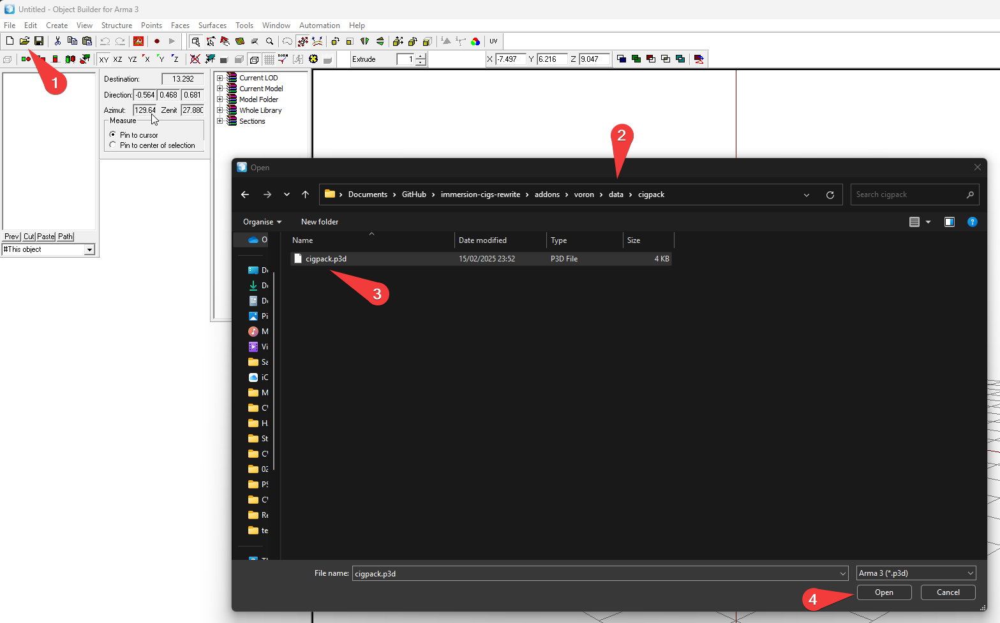
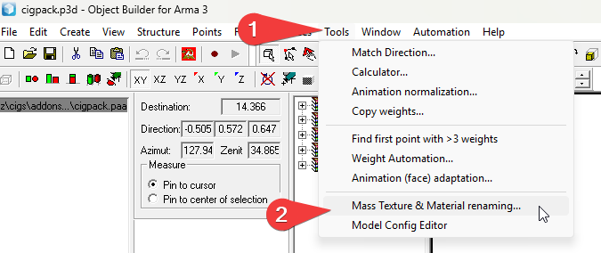
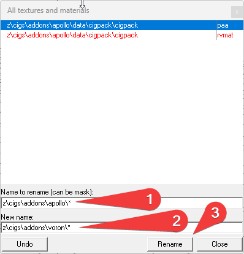

# Adding a Brand

[Back to the documentation overview](README.md) · [Modders](modders.md)

> [!TIP]
> Working with an AI coding assistant? Point it at the [LLM instructions](../tools/llm/README.md). They cover the steps below and build the texture from your pictures.

> [!TIP]
> This page is about adding a brand **to this repository**. To release a brand as **your own mod**, use the [Immersive Cigs extension template](https://github.com/OverlordZorn/immersion-cigs-extension-template) instead. It comes with its own step-by-step guide.

## How to Contribute

You have basically two options.
1. Make a PR to the main mod here and have your brand merged
2. Make a mod thats dependent on the main mod.

I would apprechiate if you do not reupload the whole mod just to add some cigs or make some minor changes.
We dont need 10 more messy and buggy cig mods on the workshop.


## 1. Copy an existing addon folder which you want to use as a base for your cig brand
Some Cigarettes have differnt models, be it the Cigarettes or the cigpacks

Keep `data/model.cfg`: it gives the pack model its own CfgModels entry. Without it the model uses the engine's global default, which other mods sometimes break. `tools/check_model_cfg.py` checks this.

## 2. Rename the Folder and replace all needed Strings inside the addon
1. `$PBOPREFIX$`
2. `script_component.hpp`
3. `stringtable.xml` - dont forget to change keys, not only the Strings themselves
4. `config.cpp` - Add yourself to the 'author' and 'authors[]'

## 3. Retexturing
### 3.1 Object Textures
One texture, `addons/~youraddon~/data/texture.paa`, covers both the pack and the cigarettes. The cigarettes are the shared models in `addons/base/data/`, which take your texture through `hiddenSelectionsTextures[]`, so you don't copy any cigarette models.

Pick the cigarette in `cigs_glasses.hpp` and `cigs_hmd.hpp`:
- with a filter (85 mm): `QPATH_BASE_MODEL_CIG0` … `CIG4`, as in `morley`
- without a filter (56 mm): `QPATH_BASE_MODEL_NOFILTER_CIG0` … `CIG4`, as in `eckstein`. The paper ends at the mouth with a tobacco end; the filter part of the texture (u 391–585) isn't used.

Either way, print the logo on the paper's end next to the filter (u 330–389): that end stays as the cigarette burns down. See [Gear Icons](gear-icons.md) for the strip's layout.

Turn the logo so it reads from the front of the cigarette: its top points towards the filter (towards the mouth end without a filter), so text runs top to bottom in the strip. Text and a mark go on top of each other along the cigarette, the mark nearer the filter. Morley, Kosmos or Lucky Strike show how it looks.

On a cigarette without a filter, keep the logo a bit away from the mouth end: around u 273–327 instead of right at the end, as on Lucky Strike and Craven.

There is a "template PSD" in `tools/PSD UI Automations` which you can use.

Or build the texture from separate pictures (one per pack face, plus a small logo for the paper) with `tools/gear_icons/texture_compose.py`. `texture_compose.py guide` draws the layout with every face's size and which way is up. See [tools/gear_icons/README.md](../tools/gear_icons/README.md#build-a-texture-from-pictures).

### 3.2 UI Textures
Furthermore, you have to place the UI textures for the Package and each stage of the cigarette.

Those can be found in `addons/~youraddon~/data/UI/`
Render them from your texture with `tools/gear_icons/gear_icons.py`, so they match the other brands. See [Gear Icons](gear-icons.md).


## 4. Fix the pack's texture path
`addons/~youraddon~/data/cigpack.p3d` still points at the texture of the addon you copied. Replace the path with the script, from the repository root:

```powershell
python tools/gear_icons/mlod.py addons/~youraddon~/data/cigpack.p3d --rename addons\morley\ addons\~youraddon~\
```

Or do it by hand in Object Builder:

### 4.1. Download Arma 3 Tools via Steam

### 4.2. Open Object Builder from Arma 3 Tools

### 4.3. For `cigpack.p3d`:

#### 4.3.1 Open p3d


#### 4.3.2 Open `Tools / Mass Texture & Material Renaming`


#### 4.3.3 Mass Rename the Paths


#### 4.3.4 Save

#### 4.3.5 Repeat


## 5. ACE Arsenal Extended
With [ACE Arsenal Extended](https://steamcommunity.com/sharedfiles/filedetails/?id=2522638637) loaded, the arsenal groups all cigarettes into one entry with a brand and a stage selector. Your brand needs three things to show up there:
1. `compat_aceax/config.cpp` and `aceax.hpp` in your addon folder (both come with the copy). They use `COMPONENT`, so there's nothing to rename. Your stage 0 cigarette (`cig0`, `cig0_nv`) is `scope = 1`, hidden from the arsenal and the Eden lists; the sub-config only loads with ACE Arsenal Extended, sets it back to `scope = 2` and includes `aceax.hpp`.
2. Your brand in `addons/base/aceax.hpp` (cigars: `addons/cigars/aceax.hpp`): its name in `values[]`, and a value class like the others, with `label = ""`, `image` pointing at your `data\ui\aceax_logo_ca.paa` and `description = ECSTRING(~youraddon~,cigarette)`.
3. The logo, the flat pack front for the button:

```powershell
python tools/gear_icons/aceax_logos.py --only ~youraddon~ --apply
```

`hemtt launch aceax` starts the game with it. Without ACE Arsenal Extended the sub-config is dropped (`skipWhenMissingDependencies`), so your addon doesn't depend on it.

## 6. Check and PR
- `hemtt check` must pass. It also bumps the build number in `addons/main/script_version.hpp`; leave that out of your commit.
- Add your pack to [classnames.md](classnames.md) and your folder to the root `license.md`.
- One PR per brand, titled `Brand - New: <Brand> cigarettes (<region>)`, label `pr/new`.
- Should AI units of a faction smoke your brand? The faction presets (`addons/ai_presets_factions/*`, see [Modders](modders.md)) are a separate PR.
