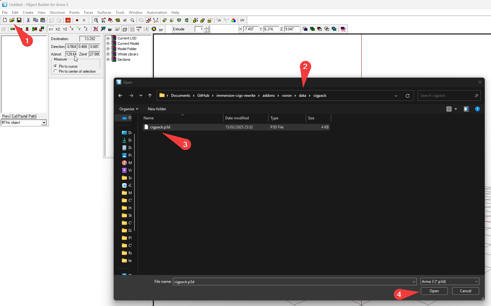
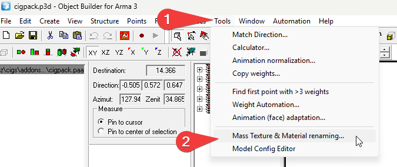
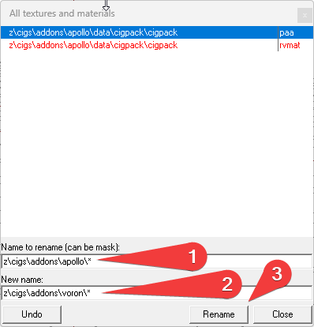

# Adding a Brand

[Back to the documentation overview](README.md) · [Modders](modders.md)

> [!TIP]
> This page is about adding a brand **to this repository**. To release a brand as **your own mod**, use the [Immersive Cigs extension template](https://github.com/OverlordZorn/immersion-cigs-extension-template) instead. It comes with its own step-by-step guide.

## How to Contribute

You have basically two options.
1. Make a PR to the main mod here and have your brand merged
2. Make a mod thats dependent on the main mod.

I would apprechiate if you do not reupload the whole mod just to add some cigs or make some minor changes.
We dont need 10 more messy and buggy cig mods on the workshop.

## 1. Copy an existing addon folder which you want to use as a base for your cig brand
Some Cigarettes have differnt models, be it the Cigarettes or the cigpacks

## 2. Rename the Folder and replace all needed Strings inside the addon
1. `$PBOPREFIX$`
2. `script_component.hpp`
3. `stringtable.xml` - dont forget to change keys, not only the Strings themselves
4. `config.cpp` - Add yourself to the 'author' and 'authors[]'

## 3. Retexturing
### 3.1 Object Textures
There are two main texture files:
1. `addons/~youraddon~/data/cigs/cigs.paa`
2. `addons/~youraddon~/data/cigpack/cigpack.paa`
   
They basically the same files, both need to be updated/replaced. (Dont ask my why, tldr: its a remnant from the original mod and i haven't bothered to clean it up).

There is a "template PSD" in `tools/PSD UI Automations` which you can use.

### 3.2 UI Textures
Furthermore, you have to place the UI textures for the Package and each stage of the cigarette.

Those can be found in `addons/~youraddon~/data/UI/`
There is also "template PSD" in `tools/PSD UI Automations` which you can use. its a bit more complex, so use with care. its WIP.

## 4. Fix the .p3d texture paths
all .p3d files within `addons/~youraddon~/data/cigs/` and `addons/~youraddon~/data/cigpack/` need their texture paths replaced, which is done with Arma 3 Tools / Object Builder

### 4.1. Download Arma 3 Tools via Steam

### 4.2. Open Object Builder from Arma 3 Tools

### 4.3. For each of the p3d files inside the addon:
by default, its `cigpack.p3d`, `cig0.p3d`,`cig1.p3d`,`cig2.p3d`,`cig3.p3d` and `cig4.p3d`

#### 4.3.1 Open p3d

#### 4.3.2 Open `Tools / Mass Texture & Material Renaming`

#### 4.3.3 Mass Rename the Paths

#### 4.3.4 Save

#### 4.3.5 Repeat
