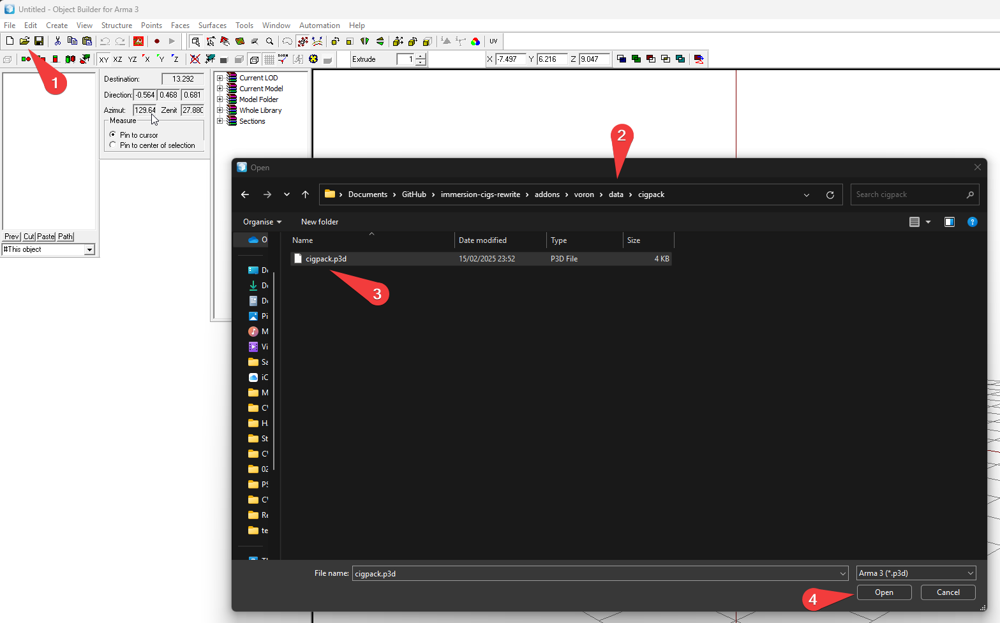
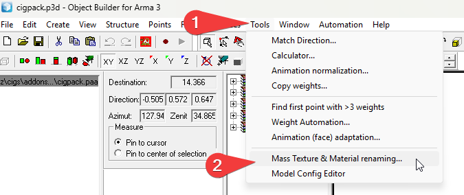
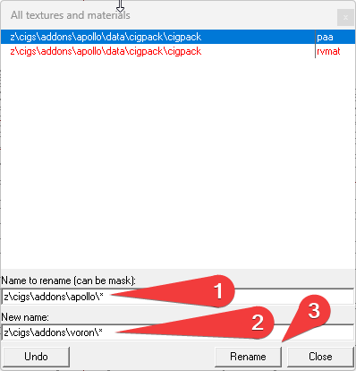

# Adding a Brand

[Back to the documentation overview](README.md) · [Modders](modders.md)

> [!TIP]
> This page is about adding a brand **to this repository**. To release a brand as **your own mod**, use the [Immersive Cigs extension template](https://github.com/OverlordZorn/immersion-cigs-extension-template) instead. It comes with its own step-by-step guide.

## How to Contribute

You have basically two options.
1. Make a PR to the main mod here and have your brand merged
2. Make a mod thats dependent on the main mod.

I would apprechiate if you do not reupload the whole mod just to add some cigs or make some minor changes.
We dont need 10 more messy and buggy cig mods on the workshop.


## 1. Copy an existing addon folder which you want to use as a base for your cig brand
Some Cigarettes have differnt models, be it the Cigarettes or the cigpacks

## 2. Rename the Folder and replace all needed Strings inside the addon
1. `$PBOPREFIX$`
2. `script_component.hpp`
3. `stringtable.xml` - dont forget to change keys, not only the Strings themselves
4. `config.cpp` - Add yourself to the 'author' and 'authors[]'

## 3. Retexturing
### 3.1 Object Textures
One texture, `addons/~youraddon~/data/texture.paa`, covers both the pack and the cigarettes. The cigarettes are the shared models in `addons/base/data/`, which take your texture through `hiddenSelectionsTextures[]`, so you don't copy any cigarette models.

Pick the cigarette in `cigs_glasses.hpp` and `cigs_hmd.hpp`:
- with a filter (85 mm): `QPATH_BASE_MODEL_CIG0` … `CIG4`, as in `morley`
- without a filter (56 mm): `QPATH_BASE_MODEL_NOFILTER_CIG0` … `CIG4`, as in `eckstein`. The paper ends at the mouth with a tobacco end; the filter part of the texture (u 391–585) isn't used.

Either way, print the logo on the paper's end next to the filter (u 330–389): that end stays as the cigarette burns down. See [Gear Icons](gear-icons.md) for the strip's layout.

There is a "template PSD" in `tools/PSD UI Automations` which you can use.

### 3.2 UI Textures
Furthermore, you have to place the UI textures for the Package and each stage of the cigarette.

Those can be found in `addons/~youraddon~/data/UI/`
Render them from your texture with `tools/gear_icons/gear_icons.py`, so they match the other brands. See [Gear Icons](gear-icons.md).


## 4. Fix the pack's texture path
`addons/~youraddon~/data/cigpack.p3d` still points at the texture of the addon you copied. Replace the path with the script, from the repository root:

```powershell
python tools/gear_icons/mlod.py addons/~youraddon~/data/cigpack.p3d --rename addons\morley\ addons\~youraddon~\
```

Or do it by hand in Object Builder:

### 4.1. Download Arma 3 Tools via Steam

### 4.2. Open Object Builder from Arma 3 Tools

### 4.3. For `cigpack.p3d`:

#### 4.3.1 Open p3d


#### 4.3.2 Open `Tools / Mass Texture & Material Renaming`


#### 4.3.3 Mass Rename the Paths


#### 4.3.4 Save

#### 4.3.5 Repeat
