# Brands

[Back to the documentation overview](README.md)

Every brand in the mod, with where it comes from, the era its pack look belongs to, and where it may be used. Check this page before you put a brand into a [faction or terrain preset](modders.md#faction-presets).

The pictures are the inventory icons (`data/UI/gear_*_ca.paa` of each brand), converted to PNG and scaled down.

## Rules for presets

- **Era first.** A preset only uses brands whose pack look fits its era. The WW2 looks (Craven "A", Eckstein, Juno, Lucky Strike, Troupes) stay in the 1940s presets (Spearhead 1944). Post-war Western filler is Marlboro and Camel, sold worldwide and so the default filler wherever a region has no brand of its own; Morley, NIL and Matelot are timeless. Two exceptions by choice: the Chernarus brands (Gudok, Zamok, Sosna) are used for Chernarus factions of every era, and Kosmos and Apollo Soyuz also go to modern Russian factions.
- **Regional brand first.** A faction or terrain lists its own region's brand first, then brands of the same region and era, then international brands that fit the era.
- **Gag brands** (Crayons, Mtn Dew Baja Blast, Black Devil Pink, Death) only go to guerrillas, criminals and the NATO crayon joke (vanilla NATO, NATO (Desert), Expeditionary Forces). Never into terrain presets, as those reach everyone; the one exception is Baja Blast and Black Devil Pink on the science fiction terrains (OPTRE, Kuiper Engagements), where no real era applies.
- **Voron** is the brand of the author's unit. It only goes to Spetsnaz, the LDF and the Looters.
- **Cigars** are for officers, at unit class level. Never per faction or terrain.
- **Only real brands for real eras.** Historical settings use the real brand with its period pack look, not an invented stand-in.

## Cigarettes

| Pack | Name | Classname | Origin | Era | Notes and restrictions | Used in |
| :--: | ---- | --------- | ------ | --- | ---------------------- | ------- |
| 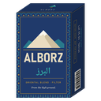 | Alborz | `cigs_alborz_cigpack` | CSAT (Iran), named after the Alborz mountains | 2035 | Main CSAT brand | CSAT, CSAT (Pacific), Viper, terrain Al Rayak, 3CB Middle East factions, CSAT |
| 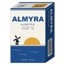 | Almyra | `cigs_almyra_cigpack` | Altis | 2035 | Regional brand of Altis and Stratis | AAF, FIA, terrains Altis and Stratis, 3CB AAF, APD, FIA |
| 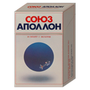 | Apollo Soyuz | `cigs_apollo_cigpack` | Soviet Union, made for the 1975 Apollo–Soyuz mission | 1975 onwards | Not before 1975, so not in S.O.G. Prairie Fire. Also used for modern Russian factions | CSAT, Spetsnaz, East Germany, Poland, CSLA, terrains Chernarus, Utes, Namalsk, the Ukrainian and Eastern European mod terrains, default EAST and CIV, RHS Russia, 3CB CSAT, CW USSR Late |
|  | Mtn Dew Baja Blast | `cigs_baja_blast_cigpack` | Gag brand | any | Tinted smoke. Gag brand: guerrillas and criminals only, plus the science fiction terrains | Syndikat, Tura, science fiction terrains, default GUER and CIV, RHS TLA, 3CB TNM |
| 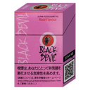 | Black Devil Pink | `cigs_black_devil_cigpack` | Netherlands, novelty pink cigarettes | modern | Gag brand: guerrillas and criminals only, plus the science fiction terrains | Syndikat, FIA, Looters, SFIA, Tura, science fiction terrains, default GUER and CIV, RHS TLA, 3CB FIA, TNM, ADG, ADM, PLM, WEI |
| 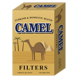 | Camel | `cigs_camel_cigpack` | USA | 1920s onwards | International Western filler, fits every era. Sold worldwide, so the default filler wherever a region has no brand, science fiction included | Many post-war Western factions and most terrains, RHS US, UN, Serbia, 3CB African factions, PLM, WEI, UN, ION, CW US |
|  | Casa Sports | `cigs_casa_sport_cigpack` | Morocco | modern | Filterless. Regional brand of North Africa | SFIA, Tura, terrains Sefrou-Ramal, Kujari, Niakala and Green Valley, 3CB African factions |
| 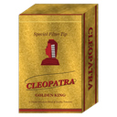 | Cleopatra | `cigs_cleopatra_cigpack` | Egypt, Eastern Company (Golden King pack) | 1961 onwards | Filter. Best-known cigarette of the Arab world and Africa. Second brand behind the regional one | SFIA, Tura, terrains Al Rayak, Sa'hatra, Green Valley, Sefrou-Ramal, Niakala and Isla Duala, 3CB Middle East and African Desert factions |
|  | Craven "A" | `cigs_craven_cigpack` | United Kingdom | WW2 | WW2 look: 1940s presets only | French Liberation Army, US Army (SPE), terrains Normandy and Mortain |
| 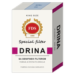 | Drina | `cigs_drina_cigpack` | Yugoslavia, Fabrika Duvana Sarajevo; later Bosnia and Serbia | 1970s–90s look | Regional brand of Serbia and the Yugoslav successor states. The Višegrad bridge over the Drina on the back | Terrain Drakovac, RHS Serbia (Army, Air Force, UN) |
| 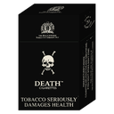 | Death | `cigs_death_cigpack` | United Kingdom, The Enlightened Tobacco Company's 1990s novelty brand, a black pack with a skull and crossbones | 1990s onwards | Black paper and filter. Gag brand: no preset of its own, arsenal and ZEN brand choice only; if ever added, guerrillas and criminals only | – |
| 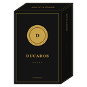 | Ducados | `cigs_ducados_cigpack` | Spain, Tabacalera | 1963 onwards | Filter. The dark "Negro" black-tobacco pack with the gold ducat. Regional brand of Spain and Sahrani | Terrains Sahrani, Southern Sahrani, United Sahrani, Porto, Rahmadi, Sehreno and Regero |
| 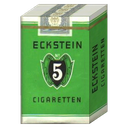 | Eckstein No. 5 | `cigs_eckstein_cigpack` | Germany | WW2 | WW2 look: 1940s presets only | Wehrmacht, Sturmtroopers, La Milice, 40s Civilians, terrains Normandy and Mortain |
| 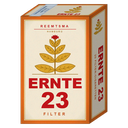 | Ernte 23 | `cigs_ernte_23_cigpack` | West Germany | 1970s–80s | Regional brand of West Germany | West Germany (GM), terrains Weferlingen and Rosche |
|  | f6 | `cigs_f6_cigpack` | East Germany (GDR), VEB Kombinat Tabak Dresden | Cold War | Regional brand of East Germany | East Germany, Revolutionaries (GM), terrains Weferlingen and Stožec |
| 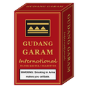 | Gudang Garam International | `cigs_gudang_garam_cigpack` | Indonesia | 1958 onwards, modern pack look | Kretek with filter; the clove is not modelled. Regional brand of Southeast Asia | Terrains Pulau, Tembelan and Prei Khmaoch Luong |
|  | Gudok | `cigs_gudok_cigpack` | Chernarus | 1980s look, used for every era | Filterless, cheap domestic. The Chernarus brands are used for Chernarus factions of any era | AFMC, terrains Chernarus, Chernarus 2020, Utes, Namalsk, Ivanivkova, Korsac, Lesser Swamp, Project Raid, Vereskovo, Yulakia, Lybor, Leskovets, RHS Eastern Militia, CDF, NAPA, ChDKZ, 3CB Chernarus factions |
|  | Hwarang | `cigs_hwarang_cigpack` | South Korea, army issue | Vietnam War | Filterless | Republic of Korea (S.O.G.) |
|  | Jaffudi | `cigs_jaffudi_cigpack` | Takistan, royal brand | Kingdom era, 1960s–80s | Regional brand of Takistan and Central Asia. Also stands in for Afghanistan and the Middle East | Terrains Takistan, Zargabad, Takistan Mountains, Desert, Shapur, Proving Grounds, Lythium, Kunduz River, Kunduz, Anizay, Uzbin Valley, North Takistan, Al Rayak and Sa'hatra, 3CB TKA, TKC, TKP, KRG, MEC |
| 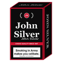 | John Silver | `cigs_john_silver_cigpack` | Sweden, Svenska Tobaks | 1947 onwards, modern pack look | Regional brand of Sweden and Norway. The health warning on the pack is replaced by a joke text | Terrains Ruha, Virolahti, Maksniemi, Stubbhult, Archie, Mehland and Tria |
| 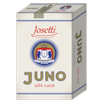 | Juno | `cigs_juno_cigpack` | Germany | WW2 | Round, filterless. WW2 look: 1940s presets only | Wehrmacht, Sturmtroopers, La Milice, terrains Normandy and Mortain |
| 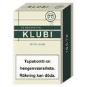 | Klubi | `cigs_klubi_cigpack` | Finland, Rettig | 1901 to the mid-2000s | Filter. Regional brand of Finland | Terrains Ruha, Virolahti and Maksniemi |
|  | Kosmos | `cigs_kosmos_cigpack` | Soviet Union | Cold War | The Eastern Bloc filler of the 1960s–80s. Also used for modern Russian factions | CSAT, Spetsnaz, GM East, CSLA, PAVN and other communist S.O.G. factions, terrains Weferlingen, Vietnam (S.O.G. and mod), Stožec, default EAST and CIV, RHS Russia, Eastern Militia, ChDKZ, 3CB LSM, Chernarus communists, KDF, Takistan, CSAT, CW USSR |
| 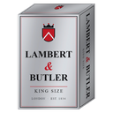 | Lambert & Butler | `cigs_lambert_butler_cigpack` | United Kingdom, London (est. 1834), the cheap everyday British cigarette | modern (silver pack, 1990s onwards) | Regional brand of the UK and British-flavoured factions | CTRG, terrains Mull of Kintyre and Djalka, 3CB BAF |
|  | Lipa | `cigs_lipa_cigpack` | Livonia | 2035 | Filterless. Regional brand of Livonia | NATO (Woodland), LDF, Looters, terrain Livonia, 3CB LDF, LFR, LNM, LSM |
|  | Lipa Dzwonek | `cigs_lipa_dzwonek_cigpack` | Livonia | 2035 | Filterless, blue "Bluebells" edition of Lipa | LDF, terrain Livonia, 3CB LDF, LFR |
| 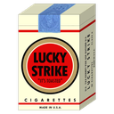 | Lucky Strike | `cigs_lucky_strike_cigpack` | USA | WW2 | WW2 look: 1940s presets only | French Interior Forces, French Liberation Army, US Army (SPE), terrains Normandy and Mortain |
|  | Marlboro | `cigs_marlboro_cigpack` | USA | 1960s onwards | International Western filler for post-war presets. Sold worldwide, so the default filler wherever a region has no brand, science fiction included | Most post-war Western factions and most terrains, RHS Russia, US, CDF, NAPA, HIDF, Serbia, most 3CB factions, 3CB BAF |
| 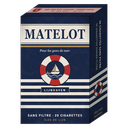 | Matelot | `cigs_matelot_cigpack` | France / Tanoa, sailors' brand | timeless | Filterless. Regional brand of Tanoa and of French settings in any era, 1944 included | NATO (Pacific), Gendarmerie, Syndikat, MJTF, French Interior Forces, 40s Civilians, terrains Tanoa, Malden, Normandy and Mortain, RHS HIDF, TLA, 3CB MDF, TNM, TPD |
| 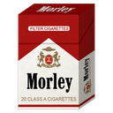 | Morley | `cigs_morley_cigpack` | Fictional, the mod's original pack | timeless | Filler for any era. Was `murshun_cigs_cigpack` in the original mod | Most Western factions, most mod terrains, default WEST and CIV, RHS US, UN, HIDF, 3CB AAF, APD, FIA, MDF, TPD, NPD, UN, ION, CW US, BAF |
| 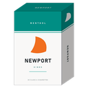 | Newport | `cigs_newport_cigpack` | USA, menthol | 1957 onwards, modern pack look | Menthol. US pop-culture pick for post-war presets | NATO, RHS US, default CIV |
|  | NIL | `cigs_nil_cigpack` | Austria | timeless | Filler for any modern preset | Many vanilla factions, vanilla terrains, most mod terrains, default CIV, 3CB AAF, APD, FIA, TPD, LDF, LFR, LNM, WEI |
| 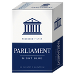 | Parliament | `cigs_parliament_cigpack` | Russia (US brand by Philip Morris), the status cigarette of Russia and the CIS | modern | Recessed filter. Premium pick for modern Russian factions, officers included | Spetsnaz, RHS Russia, 3CB LSM, KDF |
| 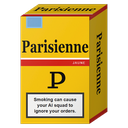 | Parisienne | `cigs_parisienne_cigpack` | Switzerland (Burrus, Boncourt; now BAT), the Swiss national brand | 1947 onwards (filtered; the brand dates from 1887) | "Jaune" pack. The bottom panel carries a joke instead of a health warning. Regional brand of Switzerland | Terrains Napf and NapfWinter |
| 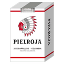 | Pielroja | `cigs_pielroja_cigpack` | Colombia | 1924 to 2019 | Filterless. Regional brand of Colombia, stands in for South America | Terrains Colombia, Lingor, Dingor and Regero |
|  | Popularne | `cigs_popularne_cigpack` | Poland | Cold War | Filterless | Poland, Revolutionaries (GM), terrains Livonia and Stožec, 3CB LNM |
| 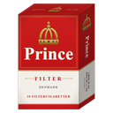 | Prince | `cigs_prince_cigpack` | Denmark | 1957 onwards | Danish, so also for Nordic peacekeepers and the Nordic terrains | Denmark (GM), UNA (WS), terrains Stubbhult, Archie, Mehland and Tria, RHS UN, Serbian UN, 3CB UN |
| 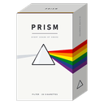 | Prism | `cigs_prism_cigpack` | Pride brand: a white pack, a prism splits a beam into the six-stripe rainbow | modern | Filter. Arsenal brand: no faction or terrain preset | – |
|  | Ruby Queen | `cigs_ruby_queen_cigpack` | South Vietnam, Cholon (Saigon) | Vietnam War | Filterless. Stands in for the whole theatre, communist side included | ARVN, Laos, Cambodia, Vietnamese civilians, PAVN, VC, Pathet Lao, Khmer Rouge, terrains Vietnam (S.O.G. and mod) |
| – | Savage Wild Tiger | `cigs_savage_cigpack` | S.O.G. Prairie Fire's own cigarettes | Vietnam War | Only exists with S.O.G. Prairie Fire loaded. Its pack picture comes from the CDLC | All S.O.G. factions, terrains Vietnam (S.O.G. and mod) |
|  | Shanhai | `cigs_shanhai_cigpack` | CSAT (China) | 2035 | Regional brand of the Pacific CSAT | CSAT (Pacific), Viper, terrain Tanoa, 3CB CSAT Pacific |
| 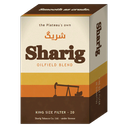 | Sharig | `cigs_sharig_cigpack` | Takistan, Sharig Plateau | 1970s oil boom | Regional brand of Takistan and Central Asia. Also stands in for Afghanistan and the Middle East | Terrains Takistan, Zargabad, Takistan Mountains, Desert, Shapur, Proving Grounds, Lythium, Kunduz River, Kunduz, Anizay, Uzbin Valley, North Takistan, Al Rayak and Sa'hatra, 3CB Takistan, Afghan, Ardistan, Karzeghistan and Middle East factions |
| 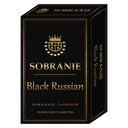 | Sobranie Black Russian | `cigs_sobranie_cigpack` | United Kingdom, Sobranie of London, luxury | post-war onwards | Black paper, gold foil filter. Luxury pick: no faction or terrain preset, take it from the arsenal or the ZEN brand choice | – |
| 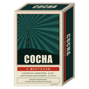 | Sosna | `cigs_sosna_cigpack` | Chernarus (Green Mountain) | 1980s look, used for every era | Menthol. The Chernarus brands are used for Chernarus factions of any era | AFMC, terrains Chernarus, Chernarus 2020, Utes, Namalsk, Ivanivkova, Korsac, Lesser Swamp, Project Raid, Vereskovo, Yulakia, Lybor, Leskovets, RHS CDF, NAPA, 3CB Chernarus factions |
|  | Sparta | `cigs_sparta_cigpack` | Czechoslovakia, Kutná Hora | 1964 onwards | Regional brand of Czechoslovakia | CSLA, FIA (CSLA), terrains Stožec, Bystrica, Bukovina and Šumava, 3CB NFA, NPD |
| 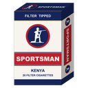 | Sportsman | `cigs_sportsman_cigpack` | Kenya, East Africa | 1950s onwards | Regional brand of sub-Saharan Africa, cork-tipped. Kneeling-rifleman emblem, red, white and navy pack | Terrains Kujari, Niakala and Isla Duala, 3CB African factions, CSAT Africa |
| 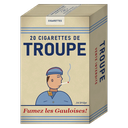 | Troupes | `cigs_troupes_cigpack` | France, army issue | WW2 | Filterless. WW2 look: 1940s presets only | La Milice, French Interior Forces, French Liberation Army, 40s Civilians, terrains Normandy and Mortain |
|  | Voron | `cigs_voron_cigpack` | The author's unit | 2035 | 24 per pack. Only Spetsnaz, LDF and Looters | Spetsnaz, LDF, Looters, 3CB LDF |
| 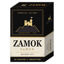 | Zamok | `cigs_zamok_cigpack` | Chernarus | 1980s look, used for every era | Premium domestic filter. The Chernarus brands are used for Chernarus factions of any era | AFMC, terrains Chernarus, Chernarus 2020, Utes, Namalsk, Ivanivkova, Korsac, Lesser Swamp, Project Raid, Vereskovo, Yulakia, Lybor, Leskovets, RHS Eastern Militia, CDF, 3CB Chernarus factions, GAF |
| 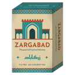 | Zargabad | `cigs_zargabad_cigpack` | Takistan, everyday bazaar brand | Kingdom era, 1960s–80s | Regional brand of Takistan and Central Asia. Also stands in for Afghanistan and the Middle East | Terrains Takistan, Zargabad, Takistan Mountains, Desert, Shapur, Proving Grounds, Lythium, Kunduz River, Kunduz, Anizay, Uzbin Valley, North Takistan, Al Rayak and Sa'hatra, 3CB Takistan, Afghan, Ardistan and Middle East factions |

## Planned brands

Brands with an open issue that faction presets already list. Their classnames are fixed on the issue; until a brand is in the mod, presets drop its pack.

| Name | Classname | Origin | Era | Planned for | Issue |
| ---- | --------- | ------ | --- | ----------- | ----- |
| Belomorkanal | `cigs_belomorkanal_cigpack` | Soviet Union / Russia, papirosa | 1932 onwards | RHS Russia, Eastern Militia, ChDKZ; 3CB Chernarus, Livonian separatists, Grozovia, Nogova, Kolgujev, Ardistan, CW USSR | #358 |

## Cigars

| Pack | Name | Classname | Origin | Era | Notes and restrictions | Used in |
| :--: | ---- | --------- | ------ | --- | ---------------------- | ------- |
| 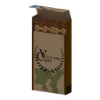 | Vulcano | `cigs_cigars_cigarbox_5` | Altis | timeless | 5 per box. Officers only, at unit class level | – |
| 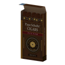 | Papa Schultz | `cigs_papa_schultz_cigarbox_5` | Halo, the Sergeant's second favourite | sci-fi | 5 per box. Officers only, at unit class level | – |

## Other smokables

| Pack | Name | Classname | Origin | Era | Notes and restrictions | Used in |
| :--: | ---- | --------- | ------ | --- | ---------------------- | ------- |
|  | Crayons | `cigs_crayons_crayonpack` | Gag brand | any | Suckable, no smoke. Only for the NATO crayon joke | NATO, NATO (Pacific), NATO (Woodland), NATO (Desert), MJTF (Desert and Woodland), default WEST and CIV |
|  | Lollipop | `cigs_pops_poppack` | – | any | Suckable, no smoke. For aid workers and civilians | IDAP, default CIV |
