# Brands

[Back to the documentation overview](README.md)

Every brand in the mod, with where it comes from, the era its pack look belongs to, and where it may be used. Check this page before you put a brand into a [faction or terrain preset](modders.md#faction-presets).

The pictures are the inventory icons (`data/UI/gear_*_ca.paa` of each brand), converted to PNG and scaled down.

## Rules for presets

- **Era first.** A preset only uses brands whose pack look fits its era. The WW2 looks (Craven "A", Eckstein, Juno, Lucky Strike, Troupes) stay in the 1940s presets (Spearhead 1944). Post-war Western filler is Marlboro and Camel, sold worldwide and so the default filler wherever a region has no brand of its own; Morley and NIL are timeless.
- **Regional brand first.** A faction or terrain lists its own region's brand first, then brands of the same region and era, then international brands that fit the era.
- **Gag brands** (Crayons, Mtn Dew Baja Blast, Black Devil Pink) only go to guerrillas, criminals and the NATO crayon joke (vanilla NATO, NATO (Desert), Expeditionary Forces). Never into terrain presets, as those reach everyone; the one exception is Baja Blast and Black Devil Pink on the science fiction terrains (OPTRE, Kuiper Engagements), where no real era applies.
- **Voron** is the brand of the author's unit. It only goes to Spetsnaz, the LDF and the Looters.
- **Cigars** are for officers, at unit class level. Never per faction or terrain.
- **Only real brands for real eras.** Historical settings use the real brand with its period pack look, not an invented stand-in.

## Cigarettes

| Pack | Name | Classname | Origin | Era | Notes and restrictions | Used in |
| :--: | ---- | --------- | ------ | --- | ---------------------- | ------- |
|  | Alborz | `cigs_alborz_cigpack` | CSAT (Iran), named after the Alborz mountains | 2035 | Main CSAT brand | CSAT, CSAT (Pacific), Viper, terrain Al Rayak |
|  | Almyra | `cigs_almyra_cigpack` | Altis | 2035 | Regional brand of Altis and Stratis | AAF, FIA, terrains Altis and Stratis |
|  | Apollo Soyuz | `cigs_apollo_cigpack` | Soviet Union, made for the 1975 Apollo–Soyuz mission | 1975 onwards | Not before 1975, so not in S.O.G. Prairie Fire | CSAT, Spetsnaz, East Germany, Poland, CSLA, terrains Chernarus, Utes, Namalsk, the Ukrainian and Eastern European mod terrains, default EAST and CIV |
| 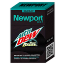 | Mtn Dew Baja Blast | `cigs_baja_blast_cigpack` | Gag brand | any | Tinted smoke. Gag brand: guerrillas and criminals only, plus the science fiction terrains | Syndikat, Tura, science fiction terrains, default GUER and CIV |
|  | Black Devil Pink | `cigs_black_devil_cigpack` | Netherlands, novelty pink cigarettes | modern | Gag brand: guerrillas and criminals only, plus the science fiction terrains | Syndikat, FIA, Looters, SFIA, Tura, science fiction terrains, default GUER and CIV |
|  | Camel | `cigs_camel_cigpack` | USA | 1920s onwards | International Western filler, fits every era. Sold worldwide, so the default filler wherever a region has no brand, science fiction included | Many post-war Western factions and most terrains |
| 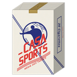 | Casa Sports | `cigs_casa_sport_cigpack` | Morocco | modern | Filterless. Regional brand of North Africa | SFIA, Tura, terrains Sefrou-Ramal, Kujari, Niakala and Green Valley |
| 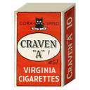 | Craven "A" | `cigs_craven_cigpack` | United Kingdom | WW2 | WW2 look: 1940s presets only | French Liberation Army, US Army (SPE), terrains Normandy and Mortain |
|  | Eckstein No. 5 | `cigs_eckstein_cigpack` | Germany | WW2 | WW2 look: 1940s presets only | Wehrmacht, Sturmtroopers, La Milice, 40s Civilians, terrains Normandy and Mortain |
|  | Ernte 23 | `cigs_ernte_23_cigpack` | West Germany | 1970s–80s | Regional brand of West Germany | West Germany (GM), terrains Weferlingen and Rosche |
| 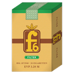 | f6 | `cigs_f6_cigpack` | East Germany (GDR), VEB Kombinat Tabak Dresden | Cold War | Regional brand of East Germany | East Germany, Revolutionaries (GM), terrains Weferlingen and Stožec |
| 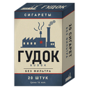 | Gudok | `cigs_gudok_cigpack` | Chernarus | 1980s | Filterless, cheap domestic | AFMC, terrains Chernarus, Chernarus 2020, Utes, Namalsk, Ivanivkova, Korsac, Lesser Swamp, Project Raid, Vereskovo, Yulakia, Lybor, Leskovets |
| 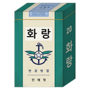 | Hwarang | `cigs_hwarang_cigpack` | South Korea, army issue | Vietnam War | Filterless | Republic of Korea (S.O.G.) |
| 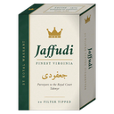 | Jaffudi | `cigs_jaffudi_cigpack` | Takistan, royal brand | Kingdom era, 1960s–80s | Regional brand of Takistan and Central Asia, stands in for the Middle East | Terrains Takistan, Zargabad, Takistan Mountains, Desert, Shapur, Proving Grounds, Lythium, Kunduz River, Uzbin Valley, North Takistan, and the Middle East terrains Al Rayak and Sa'hatra |
|  | Juno | `cigs_juno_cigpack` | Germany | WW2 | Round, filterless. WW2 look: 1940s presets only | Wehrmacht, Sturmtroopers, La Milice, terrains Normandy and Mortain |
| 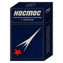 | Kosmos | `cigs_kosmos_cigpack` | Soviet Union | Cold War | The Eastern Bloc filler of the 1960s–80s | CSAT, Spetsnaz, GM East, CSLA, PAVN and other communist S.O.G. factions, terrains Weferlingen, Vietnam (S.O.G. and mod), Stožec, default EAST and CIV |
| 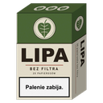 | Lipa | `cigs_lipa_cigpack` | Livonia | 2035 | Filterless. Regional brand of Livonia | NATO (Woodland), LDF, Looters, terrain Livonia |
| 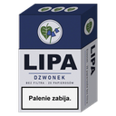 | Lipa Dzwonek | `cigs_lipa_dzwonek_cigpack` | Livonia | 2035 | Filterless, blue "Bluebells" edition of Lipa | LDF, terrain Livonia |
|  | Lucky Strike | `cigs_lucky_strike_cigpack` | USA | WW2 | WW2 look: 1940s presets only | French Interior Forces, French Liberation Army, US Army (SPE), terrains Normandy and Mortain |
| 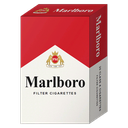 | Marlboro | `cigs_marlboro_cigpack` | USA | 1960s onwards | International Western filler for post-war presets. Sold worldwide, so the default filler wherever a region has no brand, science fiction included | Most post-war Western factions and most terrains |
|  | Matelot | `cigs_matelot_cigpack` | Tanoa, sailors' brand | 2035 | Filterless. Regional brand of Tanoa. Also used in four 1944 entries (French Interior Forces, 40s Civilians, Normandy, Mortain) | NATO (Pacific), Gendarmerie, Syndikat, MJTF, terrains Tanoa and Malden |
|  | Morley | `cigs_morley_cigpack` | Fictional, the mod's original pack | timeless | Filler for any era. Was `murshun_cigs_cigpack` in the original mod | Most Western factions, most mod terrains, default WEST and CIV |
| 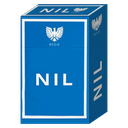 | NIL | `cigs_nil_cigpack` | Austria | timeless | Filler for any modern preset | Many vanilla factions, vanilla terrains, most mod terrains, default CIV |
| 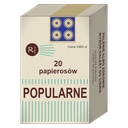 | Popularne | `cigs_popularne_cigpack` | Poland | Cold War | Filterless | Poland, Revolutionaries (GM), terrains Livonia and Stožec |
|  | Prince | `cigs_prince_cigpack` | Denmark | 1957 onwards | Danish, so also for Nordic peacekeepers and the Nordic terrains | Denmark (GM), UNA (WS), terrains Ruha, Virolahti, Maksniemi, Stubbhult, Archie, Mehland, Tria |
| 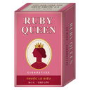 | Ruby Queen | `cigs_ruby_queen_cigpack` | South Vietnam, Cholon (Saigon) | Vietnam War | Filterless. Stands in for the whole theatre, communist side included | ARVN, Laos, Cambodia, Vietnamese civilians, PAVN, VC, Pathet Lao, Khmer Rouge, terrains Vietnam (S.O.G. and mod) |
| – | Savage Wild Tiger | `cigs_savage_cigpack` | S.O.G. Prairie Fire's own cigarettes | Vietnam War | Only exists with S.O.G. Prairie Fire loaded. Its pack picture comes from the CDLC | All S.O.G. factions, terrains Vietnam (S.O.G. and mod) |
| 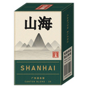 | Shanhai | `cigs_shanhai_cigpack` | CSAT (China) | 2035 | Regional brand of the Pacific CSAT | CSAT (Pacific), Viper, terrain Tanoa |
|  | Sharig | `cigs_sharig_cigpack` | Takistan, Sharig Plateau | 1970s oil boom | Regional brand of Takistan and Central Asia, stands in for the Middle East | Terrains Takistan, Zargabad, Takistan Mountains, Desert, Shapur, Proving Grounds, Lythium, Kunduz River, Uzbin Valley, North Takistan, and the Middle East terrains Al Rayak and Sa'hatra |
|  | Sosna | `cigs_sosna_cigpack` | Chernarus (Green Mountain) | late Soviet | Menthol | AFMC, terrains Chernarus, Chernarus 2020, Utes, Namalsk, Ivanivkova, Korsac, Lesser Swamp, Project Raid, Vereskovo, Yulakia, Lybor, Leskovets |
| 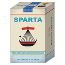 | Sparta | `cigs_sparta_cigpack` | Czechoslovakia, Kutná Hora | 1964 onwards | Regional brand of Czechoslovakia | CSLA, FIA (CSLA), terrains Stožec, Bystrica, Bukovina and Šumava |
|  | Troupes | `cigs_troupes_cigpack` | France, army issue | WW2 | Filterless. WW2 look: 1940s presets only | La Milice, French Interior Forces, French Liberation Army, 40s Civilians, terrains Normandy and Mortain |
| 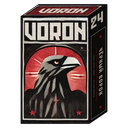 | Voron | `cigs_voron_cigpack` | The author's unit | 2035 | 24 per pack. Only Spetsnaz, LDF and Looters | Spetsnaz, LDF, Looters |
|  | Zamok | `cigs_zamok_cigpack` | Chernarus | 1980s | Premium domestic filter | AFMC, terrains Chernarus, Chernarus 2020, Utes, Namalsk, Ivanivkova, Korsac, Lesser Swamp, Project Raid, Vereskovo, Yulakia, Lybor, Leskovets |
|  | Zargabad | `cigs_zargabad_cigpack` | Takistan, everyday bazaar brand | Kingdom era, 1960s–80s | Regional brand of Takistan and Central Asia, stands in for the Middle East | Terrains Takistan, Zargabad, Takistan Mountains, Desert, Shapur, Proving Grounds, Lythium, Kunduz River, Uzbin Valley, North Takistan, and the Middle East terrains Al Rayak and Sa'hatra |

## Cigars

| Pack | Name | Classname | Origin | Era | Notes and restrictions | Used in |
| :--: | ---- | --------- | ------ | --- | ---------------------- | ------- |
|  | Vulcano | `cigs_cigars_cigarbox_5` | Altis | timeless | 5 per box. Officers only, at unit class level | – |
|  | Papa Schultz | `cigs_papa_schultz_cigarbox_5` | Halo, the Sergeant's second favourite | sci-fi | 5 per box. Officers only, at unit class level | – |

## Other smokables

| Pack | Name | Classname | Origin | Era | Notes and restrictions | Used in |
| :--: | ---- | --------- | ------ | --- | ---------------------- | ------- |
| 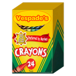 | Crayons | `cigs_crayons_crayonpack` | Gag brand | any | Suckable, no smoke. Only for the NATO crayon joke | NATO, NATO (Pacific), NATO (Woodland), NATO (Desert), MJTF (Desert and Woodland), default WEST and CIV |
|  | Lollipop | `cigs_pops_poppack` | – | any | Suckable, no smoke. For aid workers and civilians | IDAP, default CIV |
